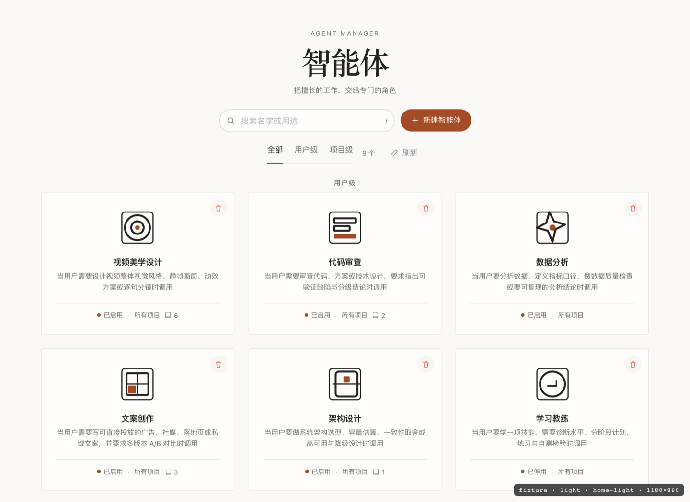
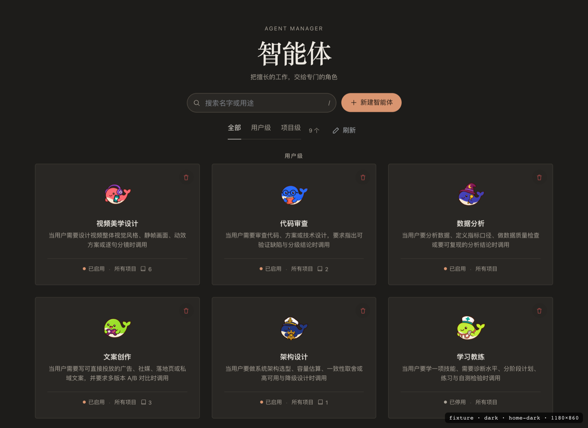
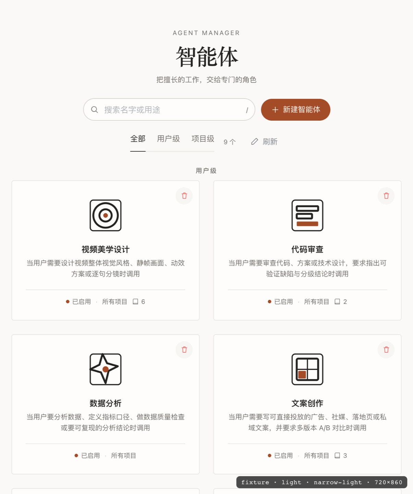
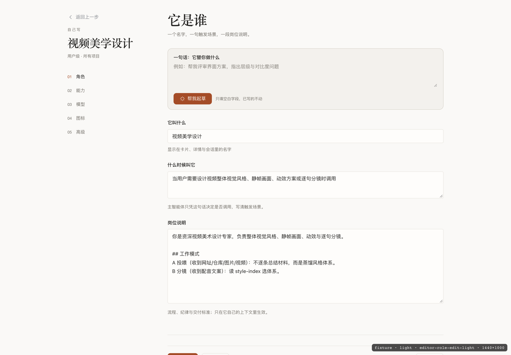
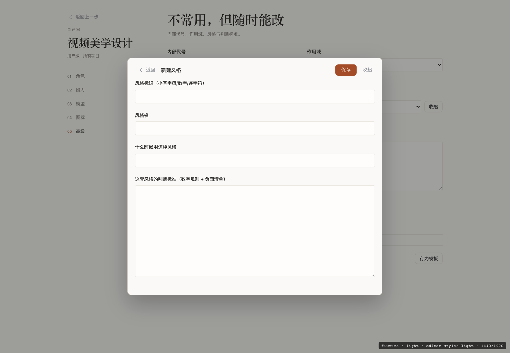

# 自定义子智能体（dsh-custom-subagents）

左侧栏常驻的面板：用 Markdown 定义可复用的智能体角色，选好工具与模型，运行时注册为 DSH 预设，一句话就能叫它出来干活。

> **名字说明**：面板里仍然叫「智能体」，实际使用不变；插件市场里显示为 **自定义子智能体**，用于和几个同名的 `dsh-agent-manager` 仓库区分。仓库与包名也已改为 `dsh-custom-subagents`，彻底避开同名仓库。



## 它做什么

- **定义角色**：每个智能体是一份 Markdown（frontmatter + 正文提示词），存在用户级或项目级目录里；保存后按需注册成 DSH 预设。
- **画廊式首页**：搜索、按作用范围筛选、卡片网格（头像/名字/一句话/状态与知识卡数量），下方是五个领域起点。
- **只读详情页**：大头像 + 一句话 + 元信息 + 四个动作（开新会话 / 编辑 / 启停 / 删除）+ 概览与知识库两个页签；长提示词默认收起。
- **五步编辑器**：01 角色 / 02 能力 / 03 模型 / 04 图标 / 05 高级，左侧编号导航，「返回上一步」不丢草稿。
- **12 份起步模板**：按视觉、技术、内容、产品运营、学习五组归组；领域卡写明会从哪份模板开始。
- **30 款透明图标**：单行横向滚动选择，选中后同步到卡片、详情与会话头部。
- **知识卡**：每个智能体有自己的知识库，可以从粘贴的文本或网址提炼，也可以在详情页手动新建/编辑。
- **风格库**：可复用的排版/配色规则，就地弹层编辑，保存后写回本机。
- **启停策略**：按项目保存在本机，项目级定义默认停用，信任策略也只存在本地。
- **并发写保护**：保存时带上读到的文件修改时间，文件在别处被改过就拒绝覆盖，并给出「读取最新版（保留我的修改）」的出路。

## 截图

| 暗色 | 窄栏（520px） |
| --- | --- |
|  |  |

| 详情 | 编辑器 | 风格库弹层 |
| --- | --- | --- |
|  |  |  |

## 安装

仓库根声明了 `dsh.bundle`（`cordis.patch.yml`），因此支持 `dsh plugin add`：

1. 在 DSH 的插件管理器里添加本仓库，或使用 `dsh plugin add` 指向本仓库；
2. 装好后侧栏出现「智能体」入口；
3. **Host 半（`index.js` / `lib/`）改动需要重启桌面端**，只改 `client.js` 时刷新页面即可。

## 数据放在哪

| 内容 | 路径 |
| --- | --- |
| 用户级智能体 | `~/.dsh/agents/<name>.md`（可用 `DSH_HOME` 覆盖） |
| 项目级智能体 | `<项目>/.dsh/agents/<name>.md` |
| 启停策略与信任 | `~/.dsh/agent-manager/projects.json` |
| 风格库 | 由 Host 侧 `lib/styles.js` 管理，随插件目录写入本机 |

首次使用建议：首页 → 挑一个领域卡（会预填提示词、工具与判断标准）→ 补上「它叫什么」「什么时候叫它」→ 创建。

## 两种叫法

- **侧栏面板**：选中智能体 → 详情 →「开新会话」。
- **会话里**：对话头部的智能体徽章菜单，选一个直接开新会话；也支持键盘上下选择、Esc 关闭并还焦。

## 设计约定

- 纸白底、墨黑字、单一暖橙强调；中文标题用宋体，正文用系统无衬线。
- 焦点与键盘是硬要求：卡片网格用 roving tabindex（整网格一个 Tab 站位）、弹层打开即聚焦并做 Tab 陷阱、关闭还焦、背景 `inert`、Esc 逐层退出（输入框 → 内层 → 屏幕）。
- 危险操作二次确认，删除会说明连带删除的知识卡数量；纯回执 6 秒自动收起，带动作的提示常驻。

## 已知边界

- 项目级定义默认停用，需要在项目设置里填写项目路径后再启用；这是既定策略，不是缺陷。
- 并发写保护依赖文件 `mtime`：另一处改动过同一份定义时，保存会被拒绝并提示重新读取，而不是静默覆盖。
- 面板宽度自适应 420–1180px；窄栏下卡片转单列。

## 文档

- [使用说明](docs/USAGE.md)：五个屏幕、字段速查、模板/图标/知识卡/策略、键盘操作、常见问题、与同名插件的区别
- [实现细节](docs/DETAIL.md)：数据模型、Host 路由、并发写保护、存储位置、前端结构

## 结构

```
index.js        Host 半：预设注册、路由、内容与模板服务
client.js       Client 半：侧栏面板、徽章菜单、四个屏幕（手写纯 JS，无打包步骤）
lib/            store（定义读写/策略/并发保护）、routes、templates、styles、knowledge、catalog、preset
templates/      12 份起步模板
seeds/          模板附带的知识卡种子
logos/          30 款 160px 透明图标
locale/         zh / en 文案
cordis.patch.yml  bundle 声明
docs/USAGE.md   用户手册
docs/DETAIL.md  实现细节与数据模型
```

MIT License.
